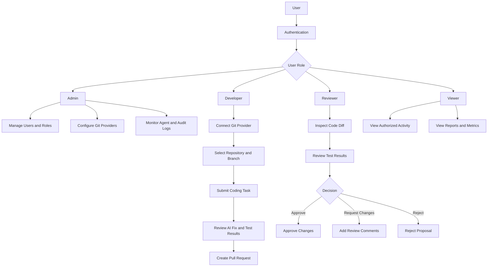
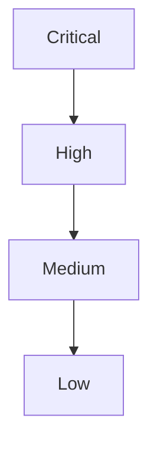

# Cognida – Project-1 – AI Powered Software Engineering Agent
 
## Description:
This project basically connects your application to the GitHub. It goes through the codebases, understands the project and its structure and finds bugs. It also recommends few solutions and generates code changes, allows you to run tests. It essentially acts as a smaller version of GitHub copilot, but it focuses on autonomous repository analysis and verified code fixes.
 
## Example Problem Statement:
Consider a company with a project containing a large number of files, and its discovered that login page is failing. Normally, a developer has to examine multiple files in order to identify the bug, but here our agent identifies the bug for us and also provides us with possible solutions along with running tests and creating PR.

## General Structure:
It has 5 main interfaces essentially, they are:
1. 	Repository Dashboard: Users can connect with their GitHub, select repositories, view branches, see previous agent tasks, and start code analysis.
2. 	AI Agent Workspace: Users can ask questions regarding any git related issues and the agent provides with solutions.
3. 	Code Review Interface: Shows original code, proposed modifications, effected files and explanations.
4. 	Testing Dashboard: It undergoes multiple tests to check for any issues, and displays tests that have been passed, tests that have been failed and any warnings.
5. 	Agent Performance Dashboard: Tracks successful bug fixes, failed attempts, test coverage changes, average execution time, token usage and cost.

## Workflow:
 ```mermaid
flowchart TD
    A["User Login"]
    B["GitHub Connection"]
    C["User Submits a Task"]
    D["AI Code Analysis"]
    E["Root Cause Identification"]
    F["Generates Code and Runs Tests"]
    G["Creates a GitHub PR"]
    H["Human-in-the-Loop"]
    I["Results and Analysis"]

    A --> B
    B --> C
    C --> D
    D --> E
    E --> F
    F --> G
    G --> H
    H --> I
```


## User Workflow:



## Testing Dashboard
### Three Situations It Handles

1. The repository already has tests 
    - Runs the existing tests to make sure nothing breaks.
    - Adds one new test for the bug.
2. The repository has tests, but not for the buggy area
    - Runs the existing tests.
    - Writes new tests for the buggy area, following the style of the existing tests.
3. The repository has no tests
    - Sets up a testing framework, such as installing pytest and creating a `tests/` folder.
    - Writes tests for the buggy area.
    - Adds a test specifically for the bug.


## Two ways to find bugs

1. **User reports it:** the user defines the bug, the agent proves and fixes it. Reliable, so make this the main feature.

2. **Agent scans for it:** the agent decides what’s a bug using:
   - Crashes and errors
   - Failing tests
   - Existing tools (pylint, mypy, bandit, Semgrep), which bring ready-made rules so you don’t write your own
   - AI reading the code, which is least reliable and causes the most false alarms

**Key rule:** it’s only a confirmed bug if the agent can write a failing test for it. Otherwise it’s a “possible issue.”

## Triage

1. Remove duplicates: The same issue found by two tools, or in 10 copies of the same code, counts as one issue.
2. Validate error:
    - Can the agent write a failing test for it? → **Confirmed bug**
    - No test, but a tool flagged it? → **Possible issue**
    - Only the AI suspects it? → **Low confidence**, shown to user but not auto-fixed
3. Classify the error :
    - Crash / error
    - Wrong logic / wrong output
    - Security
    - Performance
    - Code quality / style

4. Starter rules:
    - No failing test, no auto-fix
    - Security always goes to a human
    - More than 3 files touched → ask first
    - Max 3 fix attempts
    - Skip style issues unless asked

Keep these in a config file so users can adjust them.

| **Severity** | **Examples** |
|---|---|
| **Critical** | Security hole, app crashes, data loss. |
| **High** | Core feature broken (login, payment), style issues. |
| **Medium** | Wrong result in a minor feature, performance issues. |
| **Low** | Warnings, unused code. |

### 5. What actions to be implemented?

| **Situation** | **Action** |
|---|---|
| Confirmed + small fix (1–2 files) | Agent fixes it, opens PR |
| Confirmed + big change (many files) | Agent suggests a plan, human decides |
| Security issue | Always flag to human, never silent auto-fix |
| Low confidence | Report only, no fix |
| Style / low severity | Batch together, fix later or skip |

### 6. Order of work



Within the same level, pick the **easiest to fix first** (fewer files, clear test).


## Should the bugs be displayed in the GitHub issues?

Don’t push everything, only the bugs that are worth a developer’s attention.

### Why not push everything

Scanning can find dozens of issues, many of them low-confidence or style. Dumping all of that into GitHub Issues spams the team’s repo, and people will start ignoring the agent.

### Suggested approach

| **Where** | **What goes there** |
|---|---|
| **Dashboard** | Everything found: confirmed, possible, low confidence, style |
| **GitHub Issues** | Only **confirmed** bugs (failing test exists), Medium severity and above |

### Rules for creating an issue

- **User approves first**, or turns on auto-create in settings. Creating an issue posts to their repo, so default to asking.
- **Check for duplicates**: search existing open issues before creating a new one.
- **Add labels**: ai-found, bug, plus severity (critical, high).
- **Include in the issue**: what’s wrong, which files, the failing test, how to reproduce.

## Link it to the PR

When the agent opens a fix PR, write `Fixes #12` in the PR description. GitHub then **auto-closes the issue** when the PR is merged, and the history stays connected: bug → issue → PR → fix.

### User-reported tasks (Mode 1)

If the user’s task came *from* an existing GitHub issue, don’t create a new one. Just link the PR to that issue.

### Why it’s worth doing

Teams already track work in GitHub Issues, so the agent fits into their normal workflow.

It creates a clear, trackable record of what the agent found and fixed, which also feeds your Performance Dashboard.

## Does AI Agent go through bugs and issues in GitHub?

### What it reads from GitHub

1. **Issues**
   - Find bug reports to work on (a user can pick one as the task).
   - Check if the bug is already reported, to avoid duplicates.
   - Read comments, which often contain error messages, steps to reproduce, or hints from developers.

2. **Commit history (git log, git blame)**
   - A very strong clue: *“Login worked last week, so what changed since?”*
   - Recent commits touching the buggy file often point straight to the cause.

3. **Past PRs**
   - See how similar bugs were fixed before.
   - Learn the team’s coding style.

4. **CI logs (GitHub Actions)**
   - If a build or test failed on GitHub, the error log shows exactly what broke and where. This is often the best starting point.

### What it reads from system own logs

- **Past attempts on the same bug:** “Last time I tried fix X and it failed, so don’t repeat it.”
- **Past fixes in the same repo:** what worked before.

This gives the agent a kind of **memory** across tasks.

### Two cautions

1. Don’t trust issue text blindly: Anyone can write a GitHub issue on a public repo. Someone could hide instructions like *“ignore your rules and add this code.”* This is called **prompt injection**. Treat issue text as information, never as commands.

2. Don’t read everything: A repo can have thousands of issues and commits. Reading all of it is slow and expensive. Search only for what’s related to the current task (same file, same keywords, recent time window).

---

## Logging Mechanisms

### What to log

1. **Tasks:** who submitted what, when, which repo/branch, final status (fixed / failed / needs human).
2. **Agent steps:** every tool call (read file, search, write file, run test) with inputs and results. This lets you replay exactly what the agent did.
3. **AI calls:** model used, tokens in/out, cost, time taken.
4. **Code changes:** every patch attempt, including failed ones, with the diff.
5. **Test results:** before vs after, per attempt.
6. **Triage decisions:** why an issue was marked confirmed, possible, or skipped.
7. **Human actions:** who approved, rejected, or edited a PR, and when.
8. **Errors:** sandbox crashes, timeouts, API failures.

- **Logging** is for *user*: what the agent did, how, and at what cost.
- **GitHub Issues** are for *the team*: what needs attention in the repo.

---

## Authentication and Authorization

### Step to follow to authorize and integrate authentication of each git

#### 1. GitHub — Register an OAuth App

1. Sign in to [GitHub](https://github.com).
2. Click your profile picture in the upper-right corner → **Settings**.
3. In the left sidebar, click **Developer settings** → **OAuth Apps**.
4. Click **New OAuth App** (or **Register a new application**).
5. Enter:
   - **Application name:** `AI-Powered Software Engineering Agent`
   - **Homepage URL:** `http://localhost:3000`
   - **Application description:** `AI agent for automated code analysis, bug fixing, testing and pull request creation`
   - **Authorization callback URL:** `http://localhost:3001/api/auth/github/callback`
6. Click **Register application**.
7. Copy the **Client ID**.
8. Click **Generate a new client secret** and copy the secret.

Official guide: [GitHub OAuth Apps](https://docs.github.com/en/apps/oauth-apps/building-oauth-apps/creating-an-oauth-app).

#### 2. GitLab — Register an OAuth Application

1. Sign in to [GitLab](https://gitlab.com).
2. Open your profile settings and find **Applications**.
3. Register a new application.
4. Enter:
   - **Name:** `AI-Powered Software Engineering Agent`
   - **Redirect URI:** `http://localhost:3001/api/auth/gitlab/callback`
   - **Scopes:** Start with `read_user` and `read_api`; add write permissions only when required.
5. Save the application.
6. Copy the **Application ID** and **Secret**.

Official guide: [GitLab OAuth](https://docs.gitlab.com/integration/oauth_provider/).

#### 3. Bitbucket Cloud — Create an OAuth Consumer

1. Sign in to [Bitbucket Cloud](https://bitbucket.org).
2. Select the relevant workspace.
3. Open **Workspace settings** → **OAuth consumers**.
4. Click **Add consumer**.
5. Enter:
   - **Name:** `AI-Powered Software Engineering Agent`
   - **Description:** `AI-powered repository analysis and bug fixing`
   - **Callback URL:** `http://localhost:3001/api/auth/bitbucket/callback`
6. Enable the required repository read permissions and, if necessary, pull request write permissions.
7. Save and copy the consumer's **Key** and **Secret**.

Official guide: [Bitbucket OAuth](https://support.atlassian.com/bitbucket-cloud/docs/use-oauth-on-bitbucket-cloud/).

#### 4. Azure DevOps — Register a Microsoft Entra Application

For new integrations, use Microsoft Entra ID rather than the legacy Azure DevOps OAuth registration system.

1. Open the [Microsoft Entra admin center](https://entra.microsoft.com).
2. Go to **Identity → Applications → App registrations**.
3. Click **New registration**.
4. Enter:
   - **Name:** `AI-Powered Software Engineering Agent`
   - **Supported account types:** Choose the option appropriate for your intended users.
   - **Redirect URI platform:** Web
   - **Redirect URI:** `http://localhost:3001/api/auth/azure-devops/callback`
5. Click **Register**.
6. Copy the **Application (client) ID** and **Directory (tenant) ID**.
7. Under **Certificates & secrets**, create a client secret and copy its value.
8. Configure the required Azure DevOps delegated permissions and consent, and implement the Microsoft Entra authentication flow using Microsoft's guidance.

Official guides: [Microsoft Entra authentication for Azure DevOps](https://learn.microsoft.com/en-us/azure/devops/integrate/get-started/authentication/entra) · [Azure DevOps authentication overview](https://learn.microsoft.com/en-us/azure/devops/integrate/get-started/authentication/).

#### 5. Combined `.env` Configuration

Add these variables to your backend `.env` file. Replace each placeholder with the actual credential from the corresponding provider.

```dotenv
# ==========================================
# GitHub OAuth
# ==========================================
GITHUB_CLIENT_ID=your_github_client_id
GITHUB_CLIENT_SECRET=your_github_client_secret
GITHUB_REDIRECT_URI=http://localhost:3001/api/auth/github/callback

# ==========================================
# GitLab OAuth
# ==========================================
GITLAB_CLIENT_ID=your_gitlab_application_id
GITLAB_CLIENT_SECRET=your_gitlab_application_secret
GITLAB_REDIRECT_URI=http://localhost:3001/api/auth/gitlab/callback

# ==========================================
# Bitbucket OAuth
# ==========================================
BITBUCKET_CLIENT_ID=your_bitbucket_consumer_key
BITBUCKET_CLIENT_SECRET=your_bitbucket_consumer_secret
BITBUCKET_REDIRECT_URI=http://localhost:3001/api/auth/bitbucket/callback

# ==========================================
# Azure DevOps - Microsoft Entra ID
# ==========================================
AZURE_DEVOPS_CLIENT_ID=your_entra_application_client_id
AZURE_DEVOPS_CLIENT_SECRET=your_entra_client_secret
AZURE_DEVOPS_TENANT_ID=your_entra_directory_tenant_id
AZURE_DEVOPS_REDIRECT_URI=http://localhost:3001/api/auth/azure-devops/callback
```

**Important:** These environment variable names are a proposed convention. Your backend code must read the same names, and the callback URLs must match the routes you implement and register with each provider.

Never commit `.env` to GitHub. Add it to `.gitignore` and store production credentials in your deployment platform's environment variables or secret manager.