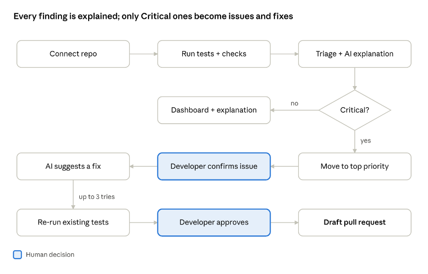
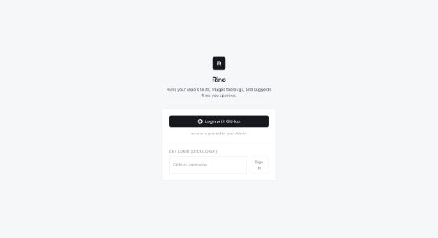
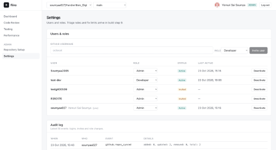
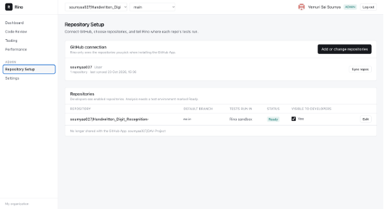
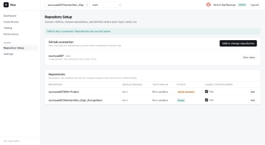
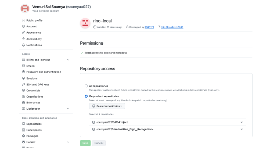

# Rino – Proof of Concept Report

| | |
|---|---|
| Project Title | Rino – AI-Powered Software Engineering Agent |
| Prepared By | Vemuri Sai Soumya, Rondla Sahasra Reddy |
| Date | 23 October 2026 |
| Mentor/Guide | Sai Kumar Yerra |

## 1. Objective

This POC checks whether an agent can connect to a team's GitHub repositories, run the tests and static checks those repos already have, sort what it finds with fixed triage rules, and hand critical bugs to a developer as a GitHub Issue with a suggested fix.

We want to confirm three things:

1. Rino can safely connect to GitHub and read only the repositories an Admin has approved.
2. Rino can work with each team's existing way of running tests (GitHub Actions, a dev instance, or its own sandbox) instead of forcing one setup.
3. Every decision that matters (severity, raising an issue, opening a pull request) stays rule-based or human-approved, and the AI is limited to explaining bugs and proposing code changes.

## 2. Problem Statement

In a large codebase, a report like "login is failing" can send a developer through dozens of files before they find the cause. Test failures, linter errors and security warnings are spread across CI logs and separate tools, and nobody has a single view of which problems are real and which matter most.

AI coding assistants can help, but they bring their own risks:

- They can make changes nobody reviewed.
- They can "fix" a bug by weakening or rewriting the tests that caught it.
- Their output is hard to audit afterwards.

Teams need a tool that finds and ranks bugs using the checks they already trust, proposes fixes, and leaves every final decision with a developer.

## 3. Proposed Solution

Rino is a web application that connects to GitHub through a GitHub App and works in five stages: connect, run, triage, explain, and propose. For v1 we deliberately kept the AI's role narrow.

Rino v1 workflow:

- It has two human checkpoints.
- Every finding gets an AI explanation, and fixed rules decide severity and priority.
- Only Critical findings go on to a GitHub Issue and a suggested fix; the repo's own tests verify the fix, and a developer approves both the issue and the pull request.

### What Rino does in v1

1. **Connect.** An Admin installs Rino's GitHub App and picks the repositories it may access.
2. **Run.** Rino runs the repo's existing pytest suite in the environment the team already uses: GitHub Actions, a dev instance (through a GitHub self-hosted runner), or Rino's own Docker sandbox. It also runs pylint and bandit.
3. **Triage.** Fixed rules, not AI, classify each finding as Critical, High, Medium or Low.
4. **Explain.** For every finding, at every severity, an LLM writes a short likely root cause and how to fix it, shown on the dashboard.
5. **Propose.** Critical findings are handled first. Only they are raised as GitHub Issues (the developer confirms each one) and get a suggested code fix. The fix is re-tested against the repo's own tests, and Rino opens a draft pull request only after a developer approves it.

### Triage rules

| # | Rule |
|---|---|
| 1 | Not a code bug: setup failures, missing third-party packages and flaky tests are logged separately and never fixed. |
| 2 | Drop noise: skip `venv/`, `build/` and `migrations/`; respect `# nosec` and `# pylint: disable`; hide style messages. |
| 3 | One cause, one finding: duplicates and many tests failing from one error are merged. |
| 4 | Severity by evidence: crashes, failing tests in core modules and high-confidence security issues are Critical. |
| 5 | Context shifts severity one level: down for `tests/` and `scripts/` code, up for regressions. |
| 6 | Critical goes to GitHub: a GitHub Issue, top priority and a suggested fix. Every other finding stays on the dashboard with its AI explanation. |

### Roles

v1 has two roles:

- An **Admin** connects GitHub, sets up repositories and manages users.
- A **Developer** runs analyses, reviews findings and approves fixes.

## 4. Technology Stack

We chose Python for the backend because the agent, the LLM calls and the analysis tools (pytest, pylint, bandit) are all Python.

| Layer | Technology | Purpose |
|---|---|---|
| Frontend | Next.js 15 (App Router, TypeScript), Tailwind CSS | Dashboards, Repository Setup, Code Review screens |
| Backend API | Python 3.11, FastAPI, Pydantic | REST API, role checks, input validation |
| Database | PostgreSQL 16, SQLAlchemy 2, Alembic | Users, repos, runs, findings, audit log; versioned migrations |
| Background jobs | Redis, RQ | Long-running analysis and fix jobs |
| Sandbox | Docker (one container per run) | Runs untrusted repo code in isolation |
| Git hosting | GitHub App (JWT + installation tokens), GitHub REST API, signed webhooks | Repo access, issues, pull requests |
| Authentication | GitHub OAuth, signed HttpOnly session cookies (PyJWT) | Login and sessions |
| Analysis tools | pytest (JUnit XML), pylint (JSON), bandit (JSON) | Tests, code errors, security issues |
| LLM | Anthropic Claude API | Root-cause explanations and suggested patches only |
| Testing | pytest, httpx MockTransport (fake GitHub API) | Automated tests for the backend |
| Local setup | Docker Compose, ngrok (for webhooks) | One-command local environment |

## 5. Implementation

We split the build into nine steps, each ending in something we can demo. Steps 1 and 2 are complete and form the base of this POC.

### Step 1: Foundation, login and roles (complete)

- Set up Docker Compose with five services: frontend, backend, worker, PostgreSQL and Redis.
- Created the database schema (organizations, users, audit log) with Alembic migrations.
- Built **Login with GitHub** using OAuth. Rino uses the GitHub token once to identify the user and does not store it.
- The first Admin is created from a configured GitHub username. Everyone else must be invited, so uninvited users are turned away.
- Enforced Admin and Developer roles on every backend endpoint. A role change or deactivation applies on the user's next request.
- Added CSRF protection and refused unsafe production settings (weak session secret, test login left on).
- Built the Settings screen: invite users, change roles, deactivate users, and view the audit log. Rino always keeps at least one Admin.

### Step 2: Connecting repositories (complete)

- Built the GitHub App install flow. An Admin clicks **Install GitHub App**, picks repositories on GitHub, and returns to Rino. A one-time state value makes sure only installs started from Rino are linked.
- Repositories sync automatically, including accounts with more than 100 repos.
- Signed webhooks keep the list current when repos are added or removed, or the app is suspended or uninstalled. Unsigned or wrongly signed webhooks are rejected.
- Built the **Repository Setup** screen, where the Admin answers "Where do your tests run?" for each repo:
  - **GitHub Actions:** Rino checks that the workflow exists, can be started on demand (`workflow_dispatch`), and uploads its test results.
  - **Dev instance:** the same checks, plus a job that runs on a self-hosted runner.
  - **Rino sandbox:** Rino checks for `requirements.txt` and tests, and only accepts a single pytest command, so no extra shell commands can be slipped in.
- Each repo is marked **Ready** or **Needs attention**, with plain-language reasons.
- Added a repo and branch picker in the top bar. Developers only see repos the Admin enabled.
- Put all GitHub calls behind a provider-neutral interface, so Bitbucket or Azure DevOps can be added later.

### Steps 3 to 9 (planned)

| Step | What it adds |
|---|---|
| 3 | Run tests in the sandbox and read the JUnit XML results |
| 4 | pylint and bandit, triage with the six rules, Repository Dashboard |
| 5 | AI explanations for every finding; GitHub Issue confirm flow for Critical findings, with duplicate check |
| 6 | Suggested fixes, safety checks, re-run of existing tests, Code Review screen |
| 7 | Developer approval, then draft pull request; Testing Dashboard |
| 8 | Running tests through GitHub Actions or a dev instance |
| 9 | Performance Dashboard, triage rules editor, fix limits |

A fix counts as verified only when the original failure is gone and no previously passing test fails. Rino makes at most three attempts.

## 6. Results and Observations

The foundation and GitHub connection work as designed: 61 automated tests pass on both SQLite and PostgreSQL, and 18 end-to-end checks pass against a running system.

### Automated tests

| Area | Result |
|---|---|
| Login and roles | Pass |
| Security | Pass |
| GitHub install | Pass |
| Webhooks | Pass |
| Repository Setup | Pass |

The tests use an in-memory fake of the GitHub API, so the real GitHub code runs end to end: App JWT signing, token exchange, pagination and file reads.

### End-to-end run

With the backend and frontend running against a fake GitHub server, we walked through the full flow through the browser-facing API.

| Check | Observed |
|---|---|
| Admin starts install | Redirected to GitHub's install page |
| Forged install link | Refused (`invalid_state`) |
| GitHub returns to Rino | Installation linked, 2 repos synced |
| Workflow without `workflow_dispatch` | Marked Needs attention with a clear reason |
| Test command with injected shell commands | Rejected (422) |
| Valid sandbox setup | Marked Ready |
| Developer views repos and branches | Sees enabled repos; default branch listed first |
| Developer calls Admin endpoints | Refused (403) |
| Admin disables a repo | Hidden from the Developer |
| Badly signed webhook | Refused (401) |
| Suspend / unsuspend webhook | Repos hidden, then shown again |
| Audit log | Install, setup, repo and webhook events all recorded |
| GitHub tokens in logs | None found |

### Screenshots

- Login page:

  

- Settings → Users & roles:

  

- Repository Setup with a repo marked Ready:

  

- Repository Setup showing Needs attention reasons:

  

- Developer view with repo and branch picker:

  

### Observations

- Checking the test environment up front catches setup problems before any analysis runs, such as a workflow that can't be started on demand.
- Supporting three test environments matters. Real projects often need databases or secrets that only exist in their own CI or dev servers.
- Keeping GitHub calls behind one interface made the code easy to test without a live GitHub account.

## 7. Limitations

- **Analysis isn't running yet.** Steps 3 to 9 are designed but not built: running tests, triage, AI explanations, GitHub Issues, suggested fixes and pull requests.
- **Python only.** v1 supports Python repos with `requirements.txt` and pytest. Other languages and test frameworks are out of scope.
- **GitHub only.** Bitbucket and Azure DevOps aren't supported yet, although the code is structured for them.
- **Setup-dependent results.** If a repo's dependencies don't install or its tests need services that aren't available, Rino reports a setup problem rather than bugs.
- **Only existing tests.** Rino can only confirm bugs the repo's tests or static checks catch. Code with no tests gets static checks only.
- **Fixes for Critical findings only.** High, Medium and Low findings get an AI explanation on the dashboard, but no GitHub Issue or suggested fix. Explaining every finding adds LLM cost, so Rino explains each merged finding once rather than every occurrence.
- **Webhooks need a public URL.** Locally they need a tunnel such as ngrok; without one, repos are refreshed with the Sync button.
- **Tested against a fake GitHub API.** The flows were verified against an in-memory GitHub stand-in, not yet against a live GitHub organization.
- **Small-to-medium repos.** Mono repos and multi-service applications are not targeted in v1.

## 8. Conclusion

The POC confirms the foundation of the approach. Rino connects securely to GitHub, limits itself to repositories an Admin approves, adapts to how each team already runs its tests, and enforces roles and an audit trail throughout. The 61 automated tests and 18 end-to-end checks show this behaviour holds, including the security checks around login, installation and webhooks.

Keeping the AI's role narrow (explaining bugs and proposing code changes, never writing tests or making decisions) makes the system easier to trust and to audit. Further development is feasible: the remaining steps build on the connection, test-environment and role model that this POC has already validated.

## 9. Future Scope

### To complete v1

- Run tests in the sandbox, GitHub Actions or a dev instance, and read the results.
- Add pylint and bandit, and apply the six triage rules.
- Add AI explanations for every finding, and the GitHub Issue confirm flow for Critical findings.
- Add suggested fixes with safety checks, the Code Review screen, and draft pull requests after approval.
- Build the Testing and Performance dashboards (fix rate, run time, token usage and cost).
- Run a pilot on a live GitHub organization with seeded bugs.

### After v1

- Suggested fixes for High-severity findings.
- Reviewer and Viewer roles, with a rule that a developer can't approve their own fix.
- Stronger fix verification with extra checks the fix was never shown.
- Support for Bitbucket and Azure DevOps.
- More languages and test frameworks (JavaScript with Jest, Java with JUnit).
- Custom security rules with Semgrep.