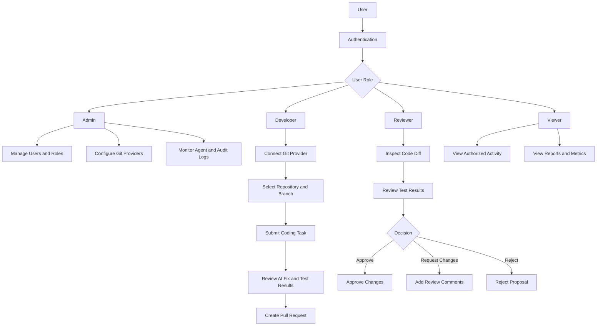
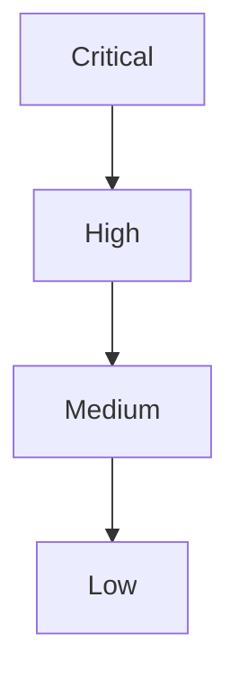
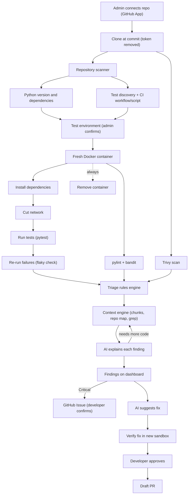
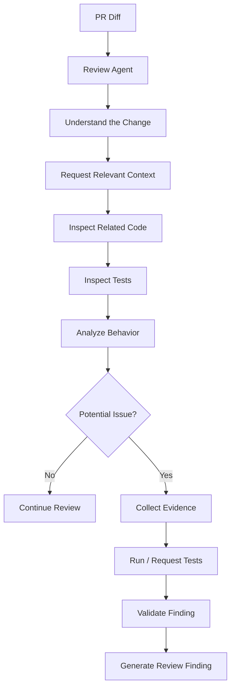
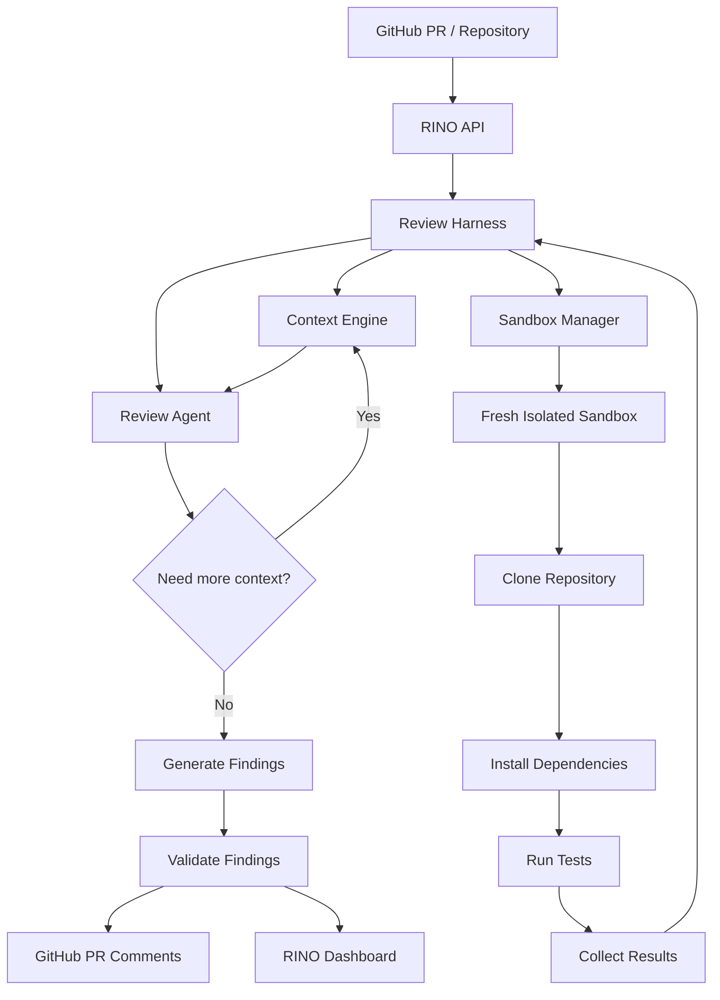

# Cognida – Project-1 – AI Powered Software Engineering Agent
 
## Description:
This project basically connects your application to the GitHub. It goes through the codebases, understands the project and its structure and finds bugs. It also recommends few solutions and generates code changes, allows you to run tests. It essentially acts as a smaller version of GitHub copilot, but it focuses on autonomous repository analysis and verified code fixes.
 
## Example Problem Statement:
Consider a company with a project containing a large number of files, and its discovered that login page is failing. Normally, a developer has to examine multiple files in order to identify the bug, but here our agent identifies the bug for us and also provides us with possible solutions along with running tests and creating PR.

## General Structure:
It has 5 main interfaces essentially, they are:
1. 	Repository Dashboard: Users can connect with their GitHub, select repositories, view branches, see previous agent tasks, and start code analysis.
2. 	AI Agent Workspace: Users can ask questions regarding any git related issues and the agent provides with solutions.
3. 	Code Review Interface: Shows original code, proposed modifications, effected files and explanations.
4. 	Testing Dashboard: It undergoes multiple tests to check for any issues, and displays tests that have been passed, tests that have been failed and any warnings.
5. 	Agent Performance Dashboard: Tracks successful bug fixes, failed attempts, test coverage changes, average execution time, token usage and cost.

## Workflow:
 ```mermaid
flowchart TD
    A["User Login"]
    B["GitHub Connection"]
    C["User Submits a Task"]
    D["AI Code Analysis"]
    E["Root Cause Identification"]
    F["Generates Code and Runs Tests"]
    G["Creates a GitHub PR"]
    H["Human-in-the-Loop"]
    I["Results and Analysis"]

    A --> B
    B --> C
    C --> D
    D --> E
    E --> F
    F --> G
    G --> H
    H --> I
```


## User Workflow:



## Testing Dashboard
### Three Situations It Handles

1. The repository already has tests 
    - Runs the existing tests to make sure nothing breaks.
    - Adds one new test for the bug.
2. The repository has tests, but not for the buggy area
    - Runs the existing tests.
    - Writes new tests for the buggy area, following the style of the existing tests.
3. The repository has no tests
    - Sets up a testing framework, such as installing pytest and creating a `tests/` folder.
    - Writes tests for the buggy area.
    - Adds a test specifically for the bug.


## Two ways to find bugs

1. **User reports it:** the user defines the bug, the agent proves and fixes it. Reliable, so make this the main feature.

2. **Agent scans for it:** the agent decides what’s a bug using:
   - Crashes and errors
   - Failing tests
   - Existing tools (pylint, mypy, bandit, Semgrep), which bring ready-made rules so you don’t write your own
   - AI reading the code, which is least reliable and causes the most false alarms

**Key rule:** it’s only a confirmed bug if the agent can write a failing test for it. Otherwise it’s a “possible issue.”

## Triage

1. Remove duplicates: The same issue found by two tools, or in 10 copies of the same code, counts as one issue.
2. Validate error:
    - Can the agent write a failing test for it? → **Confirmed bug**
    - No test, but a tool flagged it? → **Possible issue**
    - Only the AI suspects it? → **Low confidence**, shown to user but not auto-fixed
3. Classify the error :
    - Crash / error
    - Wrong logic / wrong output
    - Security
    - Performance
    - Code quality / style

4. Starter rules:
    - No failing test, no auto-fix
    - Security always goes to a human
    - More than 3 files touched → ask first
    - Max 3 fix attempts
    - Skip style issues unless asked

Keep these in a config file so users can adjust them.

| **Severity** | **Examples** |
|---|---|
| **Critical** | Security hole, app crashes, data loss. |
| **High** | Core feature broken (login, payment), style issues. |
| **Medium** | Wrong result in a minor feature, performance issues. |
| **Low** | Warnings, unused code. |

### 5. What actions to be implemented?

| **Situation** | **Action** |
|---|---|
| Confirmed + small fix (1–2 files) | Agent fixes it, opens PR |
| Confirmed + big change (many files) | Agent suggests a plan, human decides |
| Security issue | Always flag to human, never silent auto-fix |
| Low confidence | Report only, no fix |
| Style / low severity | Batch together, fix later or skip |

### 6. Order of work



Within the same level, pick the **easiest to fix first** (fewer files, clear test).


## Should the bugs be displayed in the GitHub issues?

Don’t push everything, only the bugs that are worth a developer’s attention.

### Why not push everything

Scanning can find dozens of issues, many of them low-confidence or style. Dumping all of that into GitHub Issues spams the team’s repo, and people will start ignoring the agent.

### Suggested approach

| **Where** | **What goes there** |
|---|---|
| **Dashboard** | Everything found: confirmed, possible, low confidence, style |
| **GitHub Issues** | Only **confirmed** bugs (failing test exists), Medium severity and above |

### Rules for creating an issue

- **User approves first**, or turns on auto-create in settings. Creating an issue posts to their repo, so default to asking.
- **Check for duplicates**: search existing open issues before creating a new one.
- **Add labels**: ai-found, bug, plus severity (critical, high).
- **Include in the issue**: what’s wrong, which files, the failing test, how to reproduce.

## Link it to the PR

When the agent opens a fix PR, write `Fixes #12` in the PR description. GitHub then **auto-closes the issue** when the PR is merged, and the history stays connected: bug → issue → PR → fix.

### User-reported tasks (Mode 1)

If the user’s task came *from* an existing GitHub issue, don’t create a new one. Just link the PR to that issue.

### Why it’s worth doing

Teams already track work in GitHub Issues, so the agent fits into their normal workflow.

It creates a clear, trackable record of what the agent found and fixed, which also feeds your Performance Dashboard.

## Does AI Agent go through bugs and issues in GitHub?

### What it reads from GitHub

1. **Issues**
   - Find bug reports to work on (a user can pick one as the task).
   - Check if the bug is already reported, to avoid duplicates.
   - Read comments, which often contain error messages, steps to reproduce, or hints from developers.

2. **Commit history (git log, git blame)**
   - A very strong clue: *“Login worked last week, so what changed since?”*
   - Recent commits touching the buggy file often point straight to the cause.

3. **Past PRs**
   - See how similar bugs were fixed before.
   - Learn the team’s coding style.

4. **CI logs (GitHub Actions)**
   - If a build or test failed on GitHub, the error log shows exactly what broke and where. This is often the best starting point.

### What it reads from system own logs

- **Past attempts on the same bug:** “Last time I tried fix X and it failed, so don’t repeat it.”
- **Past fixes in the same repo:** what worked before.

This gives the agent a kind of **memory** across tasks.

### Two cautions

1. Don’t trust issue text blindly: Anyone can write a GitHub issue on a public repo. Someone could hide instructions like *“ignore your rules and add this code.”* This is called **prompt injection**. Treat issue text as information, never as commands.

2. Don’t read everything: A repo can have thousands of issues and commits. Reading all of it is slow and expensive. Search only for what’s related to the current task (same file, same keywords, recent time window).

---

## Logging Mechanisms

### What to log

1. **Tasks:** who submitted what, when, which repo/branch, final status (fixed / failed / needs human).
2. **Agent steps:** every tool call (read file, search, write file, run test) with inputs and results. This lets you replay exactly what the agent did.
3. **AI calls:** model used, tokens in/out, cost, time taken.
4. **Code changes:** every patch attempt, including failed ones, with the diff.
5. **Test results:** before vs after, per attempt.
6. **Triage decisions:** why an issue was marked confirmed, possible, or skipped.
7. **Human actions:** who approved, rejected, or edited a PR, and when.
8. **Errors:** sandbox crashes, timeouts, API failures.

- **Logging** is for *user*: what the agent did, how, and at what cost.
- **GitHub Issues** are for *the team*: what needs attention in the repo.

---

## Authentication and Authorization

### Step to follow to authorize and integrate authentication of each git

#### 1. GitHub — Register an OAuth App

1. Sign in to [GitHub](https://github.com).
2. Click your profile picture in the upper-right corner → **Settings**.
3. In the left sidebar, click **Developer settings** → **OAuth Apps**.
4. Click **New OAuth App** (or **Register a new application**).
5. Enter:
   - **Application name:** `AI-Powered Software Engineering Agent`
   - **Homepage URL:** `http://localhost:3000`
   - **Application description:** `AI agent for automated code analysis, bug fixing, testing and pull request creation`
   - **Authorization callback URL:** `http://localhost:3001/api/auth/github/callback`
6. Click **Register application**.
7. Copy the **Client ID**.
8. Click **Generate a new client secret** and copy the secret.

Official guide: [GitHub OAuth Apps](https://docs.github.com/en/apps/oauth-apps/building-oauth-apps/creating-an-oauth-app).

#### 2. GitLab — Register an OAuth Application

1. Sign in to [GitLab](https://gitlab.com).
2. Open your profile settings and find **Applications**.
3. Register a new application.
4. Enter:
   - **Name:** `AI-Powered Software Engineering Agent`
   - **Redirect URI:** `http://localhost:3001/api/auth/gitlab/callback`
   - **Scopes:** Start with `read_user` and `read_api`; add write permissions only when required.
5. Save the application.
6. Copy the **Application ID** and **Secret**.

Official guide: [GitLab OAuth](https://docs.gitlab.com/integration/oauth_provider/).

#### 3. Bitbucket Cloud — Create an OAuth Consumer

1. Sign in to [Bitbucket Cloud](https://bitbucket.org).
2. Select the relevant workspace.
3. Open **Workspace settings** → **OAuth consumers**.
4. Click **Add consumer**.
5. Enter:
   - **Name:** `AI-Powered Software Engineering Agent`
   - **Description:** `AI-powered repository analysis and bug fixing`
   - **Callback URL:** `http://localhost:3001/api/auth/bitbucket/callback`
6. Enable the required repository read permissions and, if necessary, pull request write permissions.
7. Save and copy the consumer's **Key** and **Secret**.

Official guide: [Bitbucket OAuth](https://support.atlassian.com/bitbucket-cloud/docs/use-oauth-on-bitbucket-cloud/).

#### 4. Azure DevOps — Register a Microsoft Entra Application

For new integrations, use Microsoft Entra ID rather than the legacy Azure DevOps OAuth registration system.

1. Open the [Microsoft Entra admin center](https://entra.microsoft.com).
2. Go to **Identity → Applications → App registrations**.
3. Click **New registration**.
4. Enter:
   - **Name:** `AI-Powered Software Engineering Agent`
   - **Supported account types:** Choose the option appropriate for your intended users.
   - **Redirect URI platform:** Web
   - **Redirect URI:** `http://localhost:3001/api/auth/azure-devops/callback`
5. Click **Register**.
6. Copy the **Application (client) ID** and **Directory (tenant) ID**.
7. Under **Certificates & secrets**, create a client secret and copy its value.
8. Configure the required Azure DevOps delegated permissions and consent, and implement the Microsoft Entra authentication flow using Microsoft's guidance.

Official guides: [Microsoft Entra authentication for Azure DevOps](https://learn.microsoft.com/en-us/azure/devops/integrate/get-started/authentication/entra) · [Azure DevOps authentication overview](https://learn.microsoft.com/en-us/azure/devops/integrate/get-started/authentication/).

#### 5. Combined `.env` Configuration

Add these variables to your backend `.env` file. Replace each placeholder with the actual credential from the corresponding provider.

```dotenv
# ==========================================
# GitHub OAuth
# ==========================================
GITHUB_CLIENT_ID=your_github_client_id
GITHUB_CLIENT_SECRET=your_github_client_secret
GITHUB_REDIRECT_URI=http://localhost:3001/api/auth/github/callback

# ==========================================
# GitLab OAuth
# ==========================================
GITLAB_CLIENT_ID=your_gitlab_application_id
GITLAB_CLIENT_SECRET=your_gitlab_application_secret
GITLAB_REDIRECT_URI=http://localhost:3001/api/auth/gitlab/callback

# ==========================================
# Bitbucket OAuth
# ==========================================
BITBUCKET_CLIENT_ID=your_bitbucket_consumer_key
BITBUCKET_CLIENT_SECRET=your_bitbucket_consumer_secret
BITBUCKET_REDIRECT_URI=http://localhost:3001/api/auth/bitbucket/callback

# ==========================================
# Azure DevOps - Microsoft Entra ID
# ==========================================
AZURE_DEVOPS_CLIENT_ID=your_entra_application_client_id
AZURE_DEVOPS_CLIENT_SECRET=your_entra_client_secret
AZURE_DEVOPS_TENANT_ID=your_entra_directory_tenant_id
AZURE_DEVOPS_REDIRECT_URI=http://localhost:3001/api/auth/azure-devops/callback
```

**Important:** These environment variable names are a proposed convention. Your backend code must read the same names, and the callback URLs must match the routes you implement and register with each provider.

Never commit `.env` to GitHub. Add it to `.gitignore` and store production credentials in your deployment platform's environment variables or secret manager.


## Context Engine with Workflow

This is the context spec for Rino's harness. The numbers are my proposals, since only the 5-call cap and the 40k budget exist in code today. The rest should be tuned from real traces.
 
Stages A to C and the sections after them describe v1. The last section covers the final version for large repos.
 
### Stage A: pre-load (no model calls)
 
For each finding, the harness gathers these in priority order. When the budget runs short, the lowest priority is dropped first.
 
| # | What | Limit | Why |
| --- | --- | --- | --- |
| 1 | The finding's own evidence: traceback, test output, lint message, file and line | 3k tokens | Ground truth. It's what actually happened |
| 2 | The target function in full (the one the error points into) | 2k, else the signature plus lines around the error | The code being explained |
| 3 | Tests that exercise it | up to 2, 1.5k each | They show the intended behaviour |
| 4 | Direct callers and callees | up to 3 each, 800 tokens each | The code most likely to be affected |
| 5 | File header: module docstring and imports | 500 | Where names come from |
| 6 | Scoped repo map: signatures only, for the target's folder and the callers' folders | 3k | Overall picture, at about a tenth of the cost of full code |
| 7 | Project notes: an optional RINO.md, or the README's conventions | 1k | The team's own rules |
| 8 | Recent history: last 3 commit messages touching the file | 300 | Hints at why the code looks this way |
 
Target: about 15k tokens pre-loaded. The hard ceiling for the whole conversation is 40k.
 
The recipe changes with the finding type:
 
| Finding type | What step 1-2 become |
| --- | --- |
| Failing test | The traceback, the deepest product frame, and the function the assertion called |
| pylint error | The flagged line and its function; for undefined names, where the name should come from |
| bandit | The flagged line, plus how the value flows in (for example, where the SQL string's input comes from) |
| Collection or syntax error | The file around the error line; the files that import it |
| Dependency CVE (Trivy) | The dependency file line, and where the package is imported in the code |
| Flaky test | The test, the re-run results, anything it touches outside itself (time, files, network) |
 
### Stage B: the tool loop (at most 5 calls)
 
The model gets read-only tools. These five are the proposed set:
 
| Tool | Does | Output limit |
| --- | --- | --- |
| get_function(path, name) | Returns one whole function | 1.5k tokens |
| read_file(path, start, end) | Returns up to 120 lines | 1.5k tokens |
| grep(pattern, path) | Regex search | 30 matches |
| find_references(symbol) | Callers by name, narrowed by imports | 20 results |
| list_dir(path) | Lists a folder | 100 entries |
 
The script has only read_file, grep and list_dir. get_function and find_references are new, and they matter because they replace several read_file or grep calls with one.
 
What the prompt tells the model to spend calls on:
 
1. Where an unknown name is defined.
2. Who calls the function, if that affects the explanation.
3. Config or constants the function depends on.
 
The prompt only guides this. The count is enforced in code.
 
### Stage C: stop and verify
 
- Limits: 5 calls or 40k tokens. After either, the model is forced to submit.
- Every call counts, including refused ones and parallel ones.
- Output check: quoted code must exist in the file, the line must be in range, and the severity must be unchanged.
- If anything fails: the finding still shows with its rule-based details and "no explanation available".
 
### Budget by severity
 
Higher severity earns more effort, because a wrong explanation costs more there. This is my proposal and the numbers are guesses to tune.
 
| Severity | Tool calls | Token budget |
| --- | --- | --- |
| Critical | 8 | 60k |
| High | 5 | 40k |
| Medium | 3 | 25k |
| Low | 1 | 15k |
 
This also controls cost, because most findings are Medium or Low.
 
### What to log per finding
 
Calls used, tokens used (estimated and, from the API, actual), which tools, whether any output was truncated, whether the limit forced the finish, and whether validation dropped anything. After a few hundred findings, this tells you whether the caps are right.
 
### Where it runs
 
On the worker, after triage. One change is needed: Rino currently deletes the checkout when the run ends. It must keep the checkout until all findings are explained, since the tools read from it. Then it deletes it.
 
### Final version: large repos
 
The final version keeps Stages A to C and the per-finding limits. What changes is how context is found: from scanning the repo on every run to looking it up in a stored index. The per-finding budget stays the same size whether the repo has 5,000 lines or 5 million.
 
### What changes from v1
 
| Area | v1 | Final version |
| --- | --- | --- |
| Index | Function index rebuilt in memory on every run with ast | Stored per commit. Each file is hashed and only changed files are re-parsed |
| Chunks | Not stored | Function-level chunks stored with commit, path, symbol and line range |
| Callers | Found by function name | A symbol index built from imports, so find_references follows real references |
| Repo map | Cut at a fixed size | Built from the index and scoped to the finding's folder and its callers' folders |
| Search | grep (exact) | grep, keyword search and optional embedding search, merged by rank |
| Explanations | Every finding, up front | Critical and High up front; Medium and Low when someone opens them |
| Run scope | Whole repo | Admin-chosen folders; only tests related to the change; scans limited to changed files on a PR |
| Clone | Full checkout kept until explanations finish | Shallow clone or tarball, vendored and generated folders skipped |
| Languages | Python (ast) | Python first, then other languages through tree-sitter |
 
### The two phases
 
1. Index, once per commit, in the background and alongside install and tests: clone, hash the files, chunk the changed files by function, and store the chunks, symbols and import graph in Postgres (plus embeddings if enabled, cached by chunk hash).
2. Per finding: retrieve from the index, pack to the token budget, run the model loop, then validate.
 
### Tools in the final version
 
The five v1 tools stay. One optional tool is added: search_code(query), which finds code by meaning. It counts toward the same call cap, and it is added only if testing shows it finds the right function more often than grep and find_references do.
 
### Limits for large repos
 
- A maximum repo size or file count, with a clear message when it is exceeded.
- A run timeout that returns partial results and says so, instead of failing silently.
- A cap on explanations per run, taken from the highest severity down.
- Embeddings are computed once per chunk hash, so unchanged code is never embedded twice.
- The exact numbers are set from measurements on a large repo, not guessed.
 
### Build order
 
1. v1 as described above.
2. The stored index and the symbol index.
3. The scoped repo map and on-demand explanations for Medium and Low.
4. search_code with embeddings, if the test shows a gain.
5. More languages.
 
### How to check that it scales
 
Run it on one large open-source repo and measure four things: index time for a fresh repo, re-index time after a one-file change, tokens used per finding, and how often the right function appears in the top 5 results.
## Code Review Agent Workflow using harness


Building a custom code review agent harness from scratch comes down to creating a deterministic wrapper around a non-deterministic LLM. Rather than dumping an entire pull request into a single prompt, a proper harness lets the model actively investigate the codebase, verify its findings, and output structured feedback.
 
### 1. Core Harness Architecture
 
A custom harness consists of five distinct components working together:
 
* **Context & Trigger Layer:** Captures the pull request event (via GitHub Actions, GitLab CI, or a local git hook) and extracts the initial git diff and PR metadata.
* **Read-Only Toolset:** Gives the LLM safe, sandboxed tools to inspect the repository (`read_file`, `search_code`, `get_git_blame`, `run_linter`) without risking accidental edits.
* **The Agent Loop:** Manages the while loop of sending messages, executing requested tool calls, appending tool outputs, and enforcing strict iteration limits.
* **Verification & Filtering (Sensors):** Drops hallucinated line numbers, filters out low-confidence nitpicks, and formats findings into inline PR comments.
* **Structured Output Schema:** Forces the final review into predictable JSON (file path, line number, severity, and actionable fix) so your CI pipeline can post it cleanly via API.
 
### 2. Minimal Python Reference Implementation
 
You can build a working review harness in ~100 lines of Python using standard tool-calling patterns. Below is a framework-agnostic blueprint using the `openai` SDK (compatible with OpenAI, Anthropic via adapter, or local vLLM/Ollama endpoints):
 
The above code is dependent on the following open source tools:
 
* **The `openai` Python Library (`from openai import OpenAI`):** This is an external third-party package installed via pip. While it connects to OpenAI's proprietary API, the Python SDK itself, along with its underlying dependencies like `httpx`, `pydantic`, and `anyio`, is open-source software (licensed under Apache 2.0 / MIT).
* **The `git` CLI (`["git", "grep", ...]`):** The `grep_codebase` tool shells out to the `git` binary on your operating system, which is open-source software (GPLv2).
* **Python Runtime:** Python itself is open-source, though `subprocess` and `json` are built directly into its standard library.

[Python file with using open source tools](./resources/review_agent_with_open_source_tools.py)
### Building it without using open source tools
 
This complete script runs on pure Python 3 standard library with zero external installations (`pip install` is not required): 

[Python file without using open source tools](./resources/review_agent_without_open_source_tools.py)


## Harness and Sandbox


## R-A-G and  Chunking 
```mermaid
flowchart TD

    A["Finding arrives"] --> B["RETRIEVE (before the AI)<br/>function, tests, callers, map<br/>+ optional: similar code by meaning (RAG)"]

    B --> C["Prompt = rules + finding + retrieved code"]

    C --> D["AI reads it"]

    D --> E{"Needs more?"}

    E -->|Yes| F["RETRIEVE again (tool call, max 5)<br/>read_file, grep, find_references<br/>+ optional: search_code by meaning (RAG)"]

    F --> D

    E -->|No| G["AI writes the explanation"]

    G --> H["Harness checks it"]
 ```


### Decision

- Chunk code by function using Python’s `ast` module.
- Retrieve with exact symbol and keyword search first.
- Embedding search is optional. Add it only if testing shows it beats the exact methods.

### How RAG fits

- RAG means retrieving relevant material and giving it to the model before it answers.
- Retrieval happens twice in the harness. The first is the pre-load, before the AI: the finding’s evidence, the function, its tests, its callers and callees, and a scoped repo map. The second is the tool calls, during the AI’s work: `read_file`, `grep` and `find_references`, up to the call cap, plus an optional `search_code` that finds code by meaning.
- Only the embedding part is optional. Everything else works without it.

### Chunking

- AST is a tree that Python builds from the code. A function is a node in it, with exact start and end lines.
- A chunk is one whole function or method. Code outside functions (imports, constants) is its own chunk.
- Each chunk gets a header with file, class and line range, so it keeps its context.
- It’s stored with commit, path, symbol, line range and a content hash.
- Long functions are split at blank lines, with the header repeated on each piece.
- A file with a syntax error falls back to size-based splitting.
- Other languages use tree-sitter, which works the same way.
- Why not fixed-size: it cuts functions in half, so a rule and its code can end up in different chunks.
- Why not semantic chunking: code already has clear boundaries. Semantic splitting guesses them, costs an embedding call per piece, and gives less repeatable results. Meaning-based search belongs in retrieval, after splitting by function.
- Chunking runs at index time, before any finding is explained, alongside install and tests.

### Retrieval

- Exact symbol match: the most precise lookup, but it needs the exact name.
- Keyword search (Postgres full-text): good for identifiers and error messages.
- Embedding search (pgvector, optional): good for “where do we handle retries?”.
- The three result lists are merged by reciprocal rank fusion: each chunk scores the sum of `1 / (60 + rank)` across the lists it appears in.
- The query comes from the finding: the failing function’s name, the exception message, and the names called in the code.

### Storage and embeddings

- Postgres holds the chunks (path, symbol, lines, content, hash). It also holds a keyword index, and a vector column if embeddings are used.
- Embedding options: a hosted code-embedding API (simple, but code leaves Rino) or a self-hosted open model (slower, code stays inside).
- Embeddings are cached by chunk hash, so unchanged code is never embedded twice.

### Keeping the index cheap

- Git already hashes every file. If a file is unchanged, its hash is the same in the next commit.
- On each push, `git diff --name-status <last indexed> <new>` lists the files that were added, changed, deleted or renamed. Only those are re-chunked.
- Unchanged chunks keep their stored data.
- Keep a cached copy of each repo on the worker and `git fetch` only the new objects, instead of cloning every run.
- The sandbox gets a clean copy through `git archive`, with no network and no `.git`.
- Store chunks by file content hash, so a new branch reuses every unchanged file.
- Never leave the token in the repo’s config. Pass it per command.
- Cap disk per repo and evict the least recently used copies.
- After a force push, compare file trees directly or re-index.

### Packing to a token budget

- Fill the prompt in priority order: the finding’s evidence, the target function, tests, callers and callees, the file header, the scoped repo map, project notes, recent commits.
- Drop the lowest priority first when the budget runs short.
- Send signatures instead of full bodies for background code. That costs about a tenth of the tokens.
- Put fixed content (instructions, repo map) first, so prompt caching can reuse it.

### Testing it

- Use the seeded bugs as the test set. The right function is known for each.
- Compare four setups: fixed-size chunks with embeddings, function chunks with embeddings, function chunks with keyword and symbol search, and grep only.
- Measure recall in the top 5, the rank of the right function, and tokens per finding.
- Three sample repos are too few for a real result. Add 10 to 15 more seeded bugs first.
- My expectation, to be confirmed by the test: function-level chunks win, and keyword plus symbol search nearly matches embeddings at this repo size.

### Large repos

- The per-finding budget stays the same size at any repo size.
- The final version stores the index per commit and keeps a symbol index built from imports, so callers are found by real references and not by name.
- The repo map is built from the index and scoped to the finding’s folder.
- Explain Critical and High findings up front, and Medium and Low when opened.
- Limit run scope to chosen folders, set a repo size limit with a clear message, and return partial results on timeout.

### Status and build order

- Built: an in-memory function index with `ast` in the review agent script. No stored chunks and no embeddings.
- Build order:
  1. Chunker and stored chunks, with symbol and keyword search.
  2. Token packing.
  3. The seeded-bug test.
  4. Embeddings and `search_code`, only if the test shows a gain.
  5. Incremental indexing and the cached repo.

 ## Other tasks
 ## How can two open-source tools access repo at the same time?
How Concurrent Access Works:
- Concurrent Reads (Safe by Default): Operating systems allow unlimited processes to open and read the same files simultaneously. In a review harness, tools like read_file, git grep, git blame, and static analyzers (ruff, eslint) only read data, so running them in parallel causes zero conflicts.
- Git Index Locking (Write Protection): Whenever a tool modifies Git state (such as git checkout, git commit, or git fetch), Git creates a temporary .git/index.lock file. If a second tool attempts a Git write operation at the same millisecond, Git immediately blocks it with a lock error to prevent repository corruption.


Patterns for Safe Parallel Tool Execution:
If your harness runs multiple tools concurrently—or if you run two review agents against the same repository—use these patterns to avoid collisions:
- Use Git Worktrees (git worktree add): Create separate working directories linked to the same .git history. Each tool or agent operates in its own isolated folder on a different branch without duplicating the entire repository on disk.
- Enforce Read-Only Flags: Pass read-only flags to tools that normally write caches or lockfiles (for example, git --no-optional-locks status or running linters with --no-cache / --cache-dir=/tmp/...).
- Use In-Memory Parallelism in Python: Inside your harness loop, use Python's built-in concurrent.futures.ThreadPoolExecutor to run read-only tool_calls in parallel safely, while keeping any file-modifying tools sequential.

## Script should be running end-to-end from user repo to system. How?
 
#### Execution Pattern
| Feature          | Option 1: Push Model (CI/CD + SSH/WinRM)                                    | Option 2: Pull Model (Self-Hosted Runner / Agent)                                    |
| ---------------- | --------------------------------------------------------------------------- | ------------------------------------------------------------------------------------ |
| How it works     | GitHub/GitLab connects to your target machine and runs the script remotely. | An agent installed on your target machine listens for repo updates and runs locally. |
| Best for         | Cloud VMs or servers with reachable IP addresses.                           | On-premise machines behind firewalls or dynamic IPs.                                 |
| Setup complexity | Low (no agent installation needed on target).                               | Medium (requires installing a runner or management agent).                           |
 
#### Step-by-Step Implementation for Pull Model
 
Using a Self-Hosted Runner (GitHub Actions / GitLab Runner) is the cleanest way to run scripts directly on a target system without opening firewall ports:
 
1. Install the Runner on the Target System:

   * Go to your User Repo → Settings → Actions → Runners → New self-hosted runner.

   * Run the provided setup commands directly on your target Linux or Windows machine and install it as a background service (`./svc.sh install && ./svc.sh start`).

2. Add Your Script to the Repo:

   * Place your script in `scripts/setup.sh` (Linux) or `scripts/setup.ps1` (Windows) and push it to your repository.

3. Create the Automation Workflow (`.github/workflows/execute.yml`):

   * Add this file to your repo so any commit automatically executes the script on your system:
 
```yaml

name: End-to-End Repo to System Execution
 
on:

  push:

    branches: [ main ]

    paths:

      - 'scripts/**'

  workflow_dispatch: # Allows manual trigger button in GitHub UI
 
jobs:

  run-on-system:

    runs-on: self-hosted # Targets your specific machine

    steps:

      - name: Pull latest script from user repo

        uses: actions/checkout@v4
 
      - name: Execute script on Linux system

        if: runner.os == 'Linux'

        run: |

          chmod +x ./scripts/setup.sh

          ./scripts/setup.sh
 
      - name: Execute script on Windows system

        if: runner.os == 'Windows'

        shell: pwsh

        run: |

          .\scripts\setup.ps1
```